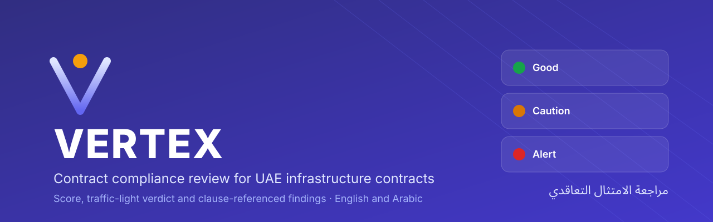
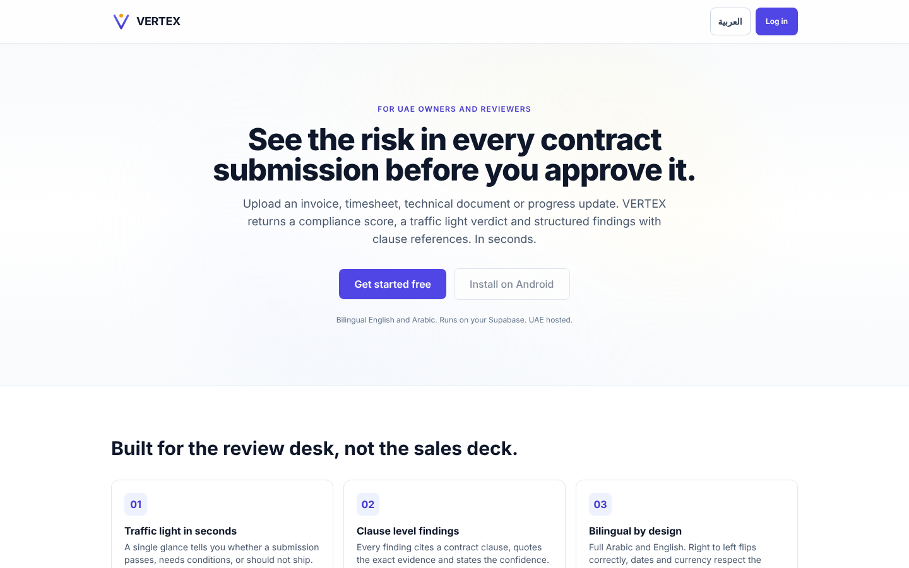
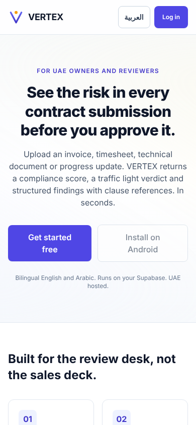
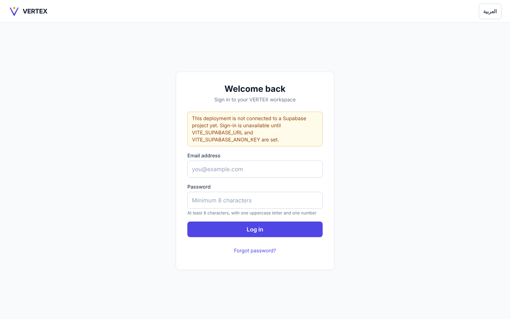
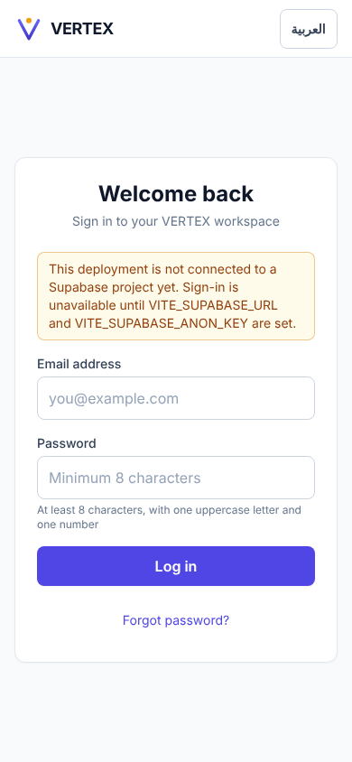
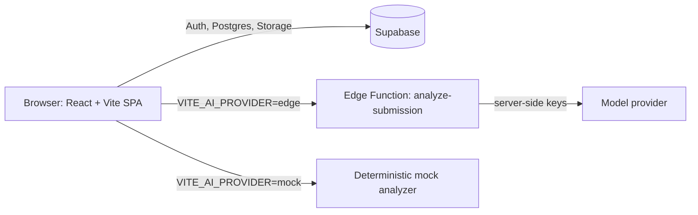

<p align="center">
  
</p>

<p align="center">
  <strong>Upload a contract submission. Get a compliance score, a traffic-light verdict and clause-referenced findings.</strong>
</p>

<p align="center">
  
  
  
  
  
  
</p>

## Overview

VERTEX is contract and project intelligence for UAE infrastructure and
services contracts. A reviewer uploads a submission (invoice, timesheet,
technical document or progress update). VERTEX returns a compliance score,
a traffic-light verdict and structured findings with clause references.
The interface is bilingual English and Arabic with full right-to-left
support, and installs on Android as a Progressive Web App.

### Product authority

| | |
|---|---|
| **Primary user** | Contract managers and commercial teams |
| **Job to be done** | Administer contract compliance end to end |
| **System of record** | Contracts, obligations, submissions, commercial and compliance review (certificates, invoices, claims, variations, bonds) |
| **System of intelligence** | Compliance matrix, findings, contractor performance scores |
| **Explicit non-goals** | Generic document chat (handled by Mutabasir), replacing formal legal opinion, any Beyond Style code |

See [`docs/PRODUCT_AUTHORITY.md`](./docs/PRODUCT_AUTHORITY.md).

## Key features

- **Submission wizard.** Four steps from upload to analysis, with client and server file validation (25 MB cap, MIME allowlist).
- **Findings review.** Tabs for findings, file preview, comments and history, plus an approval panel.
- **Compliance matrix.** Requirement by contract grid on the dashboard. The worst item decides each cell, and every cell carries a text label so colour is never the only signal.
- **KPI penalties, obligations and insurance renewals.** Dedicated pages with approval workflow and evidence upload.
- **Analytics and PDF reports.** Portfolio charts (recharts) and client-side PDF export (jsPDF) per submission or project.
- **Bilingual and RTL.** English and Arabic through i18next, with CSS logical properties so layouts mirror correctly.
- **Keys stay server side.** AI calls go through a Supabase Edge Function. A deterministic mock provider works with no keys at all.
- **Security headers.** Strict CSP, HSTS and frame denial are set in `vercel.json`. Row level security is enabled on every table.

## Screenshots

Captured from a local production build with no Supabase project configured, so the login page shows the configuration notice.

| Desktop (1440 x 900) | Mobile (390 x 844) |
|---|---|
|  |  |
|  |  |

## Quick start

```bash
npm ci
cp .env.example .env.local        # fill in Supabase URL + anon key
npm run dev                       # http://localhost:5173
```

The public pages render without a Supabase project. Analysis uses the mock
AI provider by default (`VITE_AI_PROVIDER=mock`). Without Supabase env vars
the login page says so and does not attempt to sign in. Log in with a real
Supabase user to see live data on the dashboard.

### Environment variables

`.env.example` documents every variable.

| Variable | Required | Purpose |
|---|---|---|
| `VITE_SUPABASE_URL` | For sign-in and data | Supabase project URL |
| `VITE_SUPABASE_ANON_KEY` | For sign-in and data | Supabase public anon key |
| `VITE_AI_PROVIDER` | No (default `mock`) | `mock` or `edge` (Supabase Edge Function) |

Provider keys (`ANTHROPIC_API_KEY`, `OPENAI_API_KEY`) live in **Supabase
project secrets**, never in the browser bundle.

## Scripts

| Script | What it does |
|--------|--------------|
| `npm run dev` | Vite dev server |
| `npm run build` | Type-check and build to `dist/` |
| `npm run preview` | Serve the built app |
| `npm run typecheck` | `tsc --noEmit` |
| `npm run lint` | ESLint |
| `npm run test` | Vitest unit tests |
| `npm run test:coverage` | Vitest with v8 coverage report |
| `npm run e2e` | Playwright end-to-end tests |
| `npm run e2e:install` | Install Chromium for Playwright |
| `npm run bundle:check` | Bundle size check |

## Project structure

```
src/
  pages/            route components (Landing, Login, Dashboard, Upload, ...)
  components/       auth, brand, common, compliance, dashboard, layout, submissions
  hooks/            data hooks over Supabase (useSubmissions, useObligations, ...)
  lib/              compliance-matrix.ts (pure derivation logic)
  services/         ai (mock + edge), pdf, storage, audit
  locales/          en + ar translation files
supabase/
  migrations/       0001 to 0004 SQL migrations
  functions/        analyze-submission Edge Function
tests/
  unit/             Vitest
  e2e/              Playwright
docs/               deploy, security, backups, product authority, evidence contract
```

## Architecture



### Routes

Public: `/` (landing), `/login`.

Authenticated (`ProtectedRoute` redirects to `/login` without a session):
`/dashboard`, `/upload`, `/submissions/:id`, `/projects/:id`, `/kpi`,
`/obligations`, `/insurance`, `/analytics`, `/reports`.

Static: `/manifest.webmanifest`, `/robots.txt`, `/sitemap.xml`, `/llms.txt`,
`/icon.svg`, `/apple-touch-icon.svg`, `/og-image.svg`, `/service-worker.js`.

### Database

Four migrations under `supabase/migrations/`:

- **`0001_vertex_init.sql`**: 10 tables (`users`, `projects`, `submissions`, `ai_findings`, `comments`, `kpi_tracking`, `mobilization_tracking`, `obligations`, `insurance_tracking`, `audit_log`), enums, indexes, `updated_at` triggers, and RLS policies across four roles.
- **`0002_session2.sql`**: `get_dashboard_stats()` RPC, `v_recent_activity` view, private `submissions` storage bucket, comments insert policy, hot-path indexes.
- **`0003_server_upload_validation.sql`**: server-side size and MIME checks on the `submissions` bucket.
- **`0004_evidence_id.sql`**: `evidence_id` on findings, per [`docs/contracts/EVIDENCE.md`](./docs/contracts/EVIDENCE.md).

Apply via the Supabase SQL editor or `supabase db push`.

### Edge Function

`supabase/functions/analyze-submission` proxies the AI call so keys never
leave the server.

```bash
supabase link --project-ref <ref>
supabase functions deploy analyze-submission
supabase secrets set ANTHROPIC_API_KEY=...      # optional
supabase secrets set OPENAI_API_KEY=...         # optional
supabase secrets set AI_PROVIDER=anthropic      # optional
```

Set `VITE_AI_PROVIDER=edge` in Vercel once the function is live.

## Deploy on Vercel

`vercel.json` is already in the repo.

| Setting | Value |
|---|---|
| Framework preset | Vite |
| Root directory | `./` (repository root) |
| Install command | `npm ci --no-audit --no-fund` |
| Build command | `npm run build` |
| Output directory | `dist` |
| Environment variables | `VITE_SUPABASE_URL`, `VITE_SUPABASE_ANON_KEY`, `VITE_AI_PROVIDER` |

The build succeeds with no env vars set. The landing page works, and the
login page explains that no Supabase project is connected. Full steps,
verification and rollback are in [`docs/DEPLOY.md`](./docs/DEPLOY.md).

## Continuous integration

`.github/workflows/vertex-ci.yml` runs on every PR and every push to `main`:

- **`quality`**: install, `npm audit` (production), typecheck, lint, Vitest, build with dummy Supabase env, upload `dist/`.
- **`e2e`**: installs Chromium and runs the Playwright suite after `quality` passes.

`.github/workflows/vertex-backup.yml` covers backups (see [`docs/BACKUPS.md`](./docs/BACKUPS.md)).

## Status and known limitations

Version history is in [`CHANGELOG.md`](./CHANGELOG.md) (0.0.1 to 0.6.3).

- Every authenticated page needs a Supabase project with the migrations applied. There is no offline demo data for those pages.
- The default AI provider is a deterministic mock. Real analysis needs the Edge Function deployed with provider keys.
- Password reset is handled by a workspace administrator from the Supabase dashboard. There is no self-service reset page.
- Open follow-ups are tracked in [`docs/FOLLOWUPS.md`](./docs/FOLLOWUPS.md).

## Security

See [`docs/SECURITY.md`](./docs/SECURITY.md), including
[how to report a vulnerability](./docs/SECURITY.md#reporting-a-vulnerability).

## الملخص بالعربية

<div dir="rtl" lang="ar">

**VERTEX** منصة لذكاء العقود والمشاريع، مخصّصة لعقود البنية التحتية والخدمات في دولة الإمارات العربية المتحدة.
يرفع المراجِع مستنداً تعاقدياً (فاتورة، أو كشف ساعات عمل، أو مستند فني، أو تقرير تقدّم)، فتُعيد المنصة درجة امتثال، وحكماً بنظام إشارات المرور، وملاحظات منظَّمة مرتبطة ببنود العقد.
الواجهة ثنائية اللغة (العربية والإنجليزية) وتدعم الاتجاه من اليمين إلى اليسار بالكامل، ويمكن تثبيتها على أجهزة أندرويد كتطبيق ويب تقدّمي.
تتطلّب الصفحات المحمية مشروع Supabase مُهيّأً، ويعمل التحليل افتراضياً بمزوّد تجريبي محدّد النتائج إلى أن تُنشر الدالة الطرفية بمفاتيح المزوّد.

</div>

## Ownership

Owned by Ahmed Zaian. No open-source license file is included, so all rights are reserved by default.
